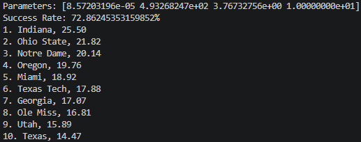
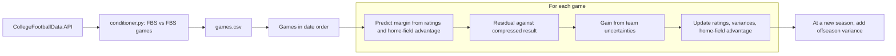

# CFB-Predictor

**An online team-rating model that predicts college football winners and point spreads from game results, using uncertainty-weighted updates and compressed score margins.**


<p align="center"></p>

Carter Tucker

---

## Overview

A point spread summarizes how much better one team is expected to be than another. This project estimates that directly from historical results. Every FBS team carries a strength rating and an uncertainty. Games are processed in date order. Before each game, the model predicts the margin from the two teams' ratings plus home-field advantage. It then compares the prediction to the result and updates both ratings. How far a rating moves depends on how uncertain the model is about the two teams, so a team the model knows little about adjusts quickly, and an established team adjusts slowly.

The project went through six versions, from a fixed-step rating update (v0) to an uncertainty-weighted model with learned home-field advantage, bounded hyperparameter optimization, and tanh compression of blowout margins (v5). See [Model Versions](#model-versions).

Version 5, the current version, was used to predict the winner and spread of last year's College Football Playoff game (Indiana vs. Miami, Jan 19), and its spread landed closer to the final margin than ESPN's. See the [Playoff Case Study](#playoff-case-study).

The model uses only final scores, team IDs, game location (home or neutral site), and season. It does not use player-level information such as recruiting, injuries, or returning production.

## Playoff Case Study

| Item | Value |
|---|---|
| Game | 25-26 College Football Playoff |
| Date | Jan 19, 2025 |
| Site | Hard Rock Stadium in Miami Gardens, Fl |
| Model version used | v5 |
| Training seasons | 2015-2024 |
| Test season | 2025 season |
| Model prediction | Indiana by 4.1 (UNDER)|
| ESPN prediction | Indiana by 4.9 (UNDER)|
| Public prediction | Indiana by 7.5 (OVER)|
| Final result | Indiana by 6 |
| Absolute error, model | -1.9 |
| Absolute error, ESPN | -1.1 |
| Absolute error, public | +1.0 |

Absolute error is the absolute difference between the predicted spread and the final margin.

This is one game. A spread landing closer than ESPN's once is consistent with a better model, but it is also something luck alone produces some of the time, so it says little about general accuracy. The [Evaluation](#evaluation) section is where that question is addressed.

## Evaluation

As committed, v5 trains on the 2015 to 2023 seasons and tests on 2024 and 2025. The run behind the playoff prediction used a longer training window (roughly 2010 to 2024) and tested on the 2025 season. Testing is chronological and online: each test game is predicted before its result is incorporated, and then its result updates the ratings used for later test games. Two metrics come out of the test run: accumulated squared error on the compressed-margin scale (the quantity the optimizer minimizes), and winner accuracy, the share of games where the sign of the predicted margin matches the sign of the actual margin (ties excluded).

| Metric (v5, 2025 season) | Value |
|---|---|
| Winner accuracy | 72.9% |
| Squared error, compressed-margin scale | To come! |
| Mean absolute error in points | To come! |
| Same metrics for a baseline (for example, always pick the home team) | To come! |
| Same metrics for the closing betting lines over the same games | To come! |

## Method



Each team has a strength $S$ (initially 0) and a variance $P$ that measures uncertainty (initially 50 in v5). A positive margin favors the home team. The predicted margin is

$$\hat m = S_h - S_a + H$$

where the home-field advantage $H$ is included only for games not played at a neutral site. After the game, the residual is computed against the compressed observed margin $f(m)$:

$$e = f(m) - \hat m$$

The two teams' variances set an adaptive gain, with $R$ the assumed observation noise:

$$K = \frac{P_h + P_a}{P_h + P_a + R}$$

The ratings, variances, and home-field advantage are then updated:

$$S_h \leftarrow S_h + K e \qquad S_a \leftarrow S_a - K e$$

$$P_i \leftarrow (1 - K)\,P_i + Q_\mathrm{week} \quad (i \in \{h, a\}) \qquad H \leftarrow H + \gamma e \quad (\text{non-neutral games only})$$

When the season changes, every team's variance increases by $Q_\mathrm{offseason}$:

$$P_i \leftarrow P_i + Q_\mathrm{offseason}$$

This raises uncertainty without claiming which teams got stronger or weaker, so early-season results move ratings more. The update is Kalman-filter inspired. It is not a full Kalman filter implementation.

### Margin compression

$$f(m) = k \tanh\!\left(\frac{m}{k}\right), \qquad k = 30$$

Small margins pass through almost unchanged, and large margins are squeezed toward $\pm k$, so a 50-point win counts as less than proportionally more evidence than a 30-point win. The compression is applied to the observed margin only, so the ratings and predicted margin live on the compressed scale.

| Raw margin | 3 | 7 | 10 | 14 | 20 | 30 | 50 |
|---|---|---|---|---|---|---|---|
| Compressed ($k = 30$) | 2.99 | 6.88 | 9.65 | 13.07 | 17.48 | 22.85 | 27.93 |

### Parameters (v5)

| Parameter | Role | Value or search bounds |
|---|---|---|
| $k$ | Compression scale | 30, fixed (not learned) |
| $H$ | Home-field advantage | Learned online |
| $\gamma$ (`gamma1`) | Home-field learning rate | 1e-6 to 1e-4, start 1e-5 |
| $R$ (`R_var`) | Observation noise | 50 to 500, start 150 |
| $Q_\mathrm{week}$ | Process noise added after each game | 0.01 to 3, start 1 |
| $Q_\mathrm{offseason}$ | Variance added at a season change | 10 to 100, start 50 |

The four tunable parameters are found with bounded Nelder-Mead search (`scipy.optimize.minimize`), which repeatedly runs the train-then-test pipeline and minimizes accumulated squared error. The search tunes four hyperparameters. The ratings themselves are always updated by the sequential rules above, so this is not a conventional supervised learner.

## Model Versions

Each version is a refinement of the same core idea: predict a margin from relative strength and correct the strengths after each game.

| Version | Main change | Home-field advantage | Offseason handling | Margin | Train and test seasons |
|---|---|---|---|---|---|
| v0 | Fixed-step updates, $\beta = 0.03$ | None | None | Raw | None (single pass) |
| v1 | Fixed-step updates, $\beta = 0.095$ | Fixed, about 4.9059 points | Ratings multiplied by 0.8 after a gap over 150 days | Raw | None |
| v2 | Uncertainty-weighted updates | Learned, starts at 3 | Variance increased | Raw | None |
| v3 | Train and test split, Nelder-Mead search over 4 hyperparameters | Learned | Variance reset to $Q_\mathrm{offseason}$ | Raw | 2010 to 2020, 2020 to 2025 (overlap) |
| v4 | Bounded search | Learned | Variance increased | Raw | 2016 to 2024, 2025 |
| v5 | Tanh margin compression, season-column logic, winner accuracy in testing | Learned | Variance increased | Compressed | 2015 to 2023, 2024 to 2025 as committed (playoff run: about 2010 to 2024, 2025) |

## Data

Games come from the [CollegeFootballData](https://collegefootballdata.com) API. [`conditioner.py`](conditioner.py) retrieves them and keeps games where both teams are FBS. Each row has the game date, season and season type, home and away team names and IDs, a neutral-site flag, home and away scores with scoring by period, and the final margin (home points minus away points). Teams are keyed by ID. Row order matters because games are processed sequentially.

## Repository Structure

```
CFB-Predictor/
├── cfb_predictor_lib.py          
├── conditioner.py                Retrieves games from the CollegeFootballData API, keeps FBS vs FBS
├── projector_v0/
│   └── projector_v0.py
├── projector_v1/
│   └── projector_v1.py
├── projector_v2/
│   └── projector_v2.py
├── projector_v3/
│   ├── cfbModel.py               train() and test()
│   ├── cfbModelFramework.py      Game loading, team initialization, season-change logic
│   ├── experiments.py            Nelder-Mead hyperparameter search
│   └── games.csv
├── projector_v4/                 Same layout as v3
└── projector_v5/                 Current version, used for the playoff prediction
    ├── cfblib.py                 Loading, initialization, season change, offseason update, margin prediction, compression
    ├── cfbModel.py               Model training and testing
    ├── experiments.py            Nelder-Mead hyperparameter search
    ├── games.csv
    └── notes.txt                 Ideas for future work
```

Each version folder contains a companion library python script used during the training and testing of the model.

## Reproducing the Results

**Requirements:** Python 3 (3.13), SciPy, CollegeFootballData API key to regenerate `games.csv`.

1. Clone the repo.
2. Generate `games.csv` with `conditioner.py` 
3. From `projector_v5/`, run the experiment. As committed, it trains on 2015 to 2024, tunes the four hyperparameters on the test seasons, and reports test error and winner accuracy. 

v0 to v2 are standalone scripts that load the games, process them in order, and print the win/loss success rate and the top 25 teams. The games.csv database is expected to be at the same level as the prediction script.

## Limitations

- **Online testing.** A test game's result updates the model after that game's prediction, so later test games benefit from earlier ones. This is not a frozen model predicting a whole season.
- **Tuning on the test period.** In the experiments, the hyperparameter search minimizes error on the test seasons themselves, so reported test error is optimistic. A cleaner design tunes on a validation period and reports on later seasons the search never saw. The 2025 season is an independent test only if the hyperparameters were fixed using data from before 2025.
- **Different losses by version.** v3 trains through 2020 and tests from 2020, so the split overlaps. v4 trains on squared raw-margin residuals but tests with absolute residuals. v5 uses squared residuals on compressed margins for both. Results are not comparable across versions without re-running them under one protocol.
- **Compression is fixed.** The scale $k = 30$ is set by hand, not learned, and compression is applied to the observed margin only.
- **Point predictions.** The predicted margin comes from the ratings alone. The tracked variances set the update gain but are not used to produce a win probability or interval.
- **No player-level information.** Recruiting, injuries, coaching changes, and returning production are not modeled. Offseason change is handled only by increasing uncertainty.
- **One playoff game.** The playoff comparison with ESPN is a single game.
- **Error handling.** Several versions use bare `except: pass`, which silently skips failures and can hide data or modeling errors. v1 also indexes the previous row with a negative index on the first game, which refers to the last row instead of meaning that no earlier game exists.

**Future work** (from `projector_v5/notes.txt`, none implemented yet): L2 regularization, team strength in the loss, weighting games by weeks since Week 1, an explicit loss function, central finite-difference gradients, and further development of the margin transformation. Other options: learning $k$, using the variances for win probabilities, and a three-way train, validation, and test split. Make a UI.

## Why I Built This

During MIT's Independent Activities Period, I was stuck in my dorm without a good project to work on. I had been watching Texas A&M's season and keeping up with the College Football Playoffs, because they were finally competitors in the playoff in the new 12-team layout and I wanted to see what came of the Indiana Hoosiers Cinderella story of a season. For about a week, I researched and iterated on the initial model, which was just an Elo-based approach with a set home-field-advantage (HFA). I wasn't happy with the results, and thought that I could better predict the playoff game than ESPN (still a goal, may not be realistic) while using basic game data. After watching the entirety of Jack Ryan and a couple wellness checks from my friends, I had come up with the last predictor, v5. Though it didn't beat ESPN's spread prediction, it did correctly take the under for spread. For starting the project with absolutely no experience with ML, and having a working model in around 5 days, I was content. Nonetheless, there is more to come.

## Citation

```bibtex
@misc{tucker2026cfbpredictor,
  author = {Tucker, Carter},
  title  = {CFB Predictor: An Online Uncertainty-Weighted Rating Model for College Football Margins},
  year   = {2026},
  url    = {https://github.com/CarterTucker/CFB-Predictor}
}
```

## Acknowledgments

Game data provided by [CollegeFootballData.com](https://collegefootballdata.com).

## Contact

Carter Tucker: [LinkedIn]([https://www.linkedin.com/in/TODO](https://www.linkedin.com/in/carter-tucker-36083b32a/)) 
